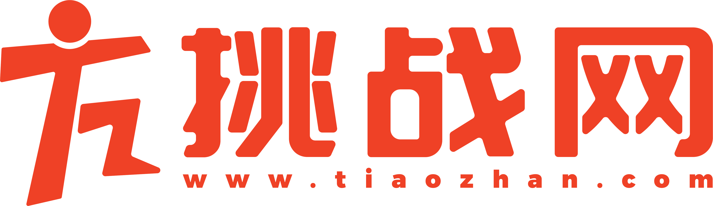
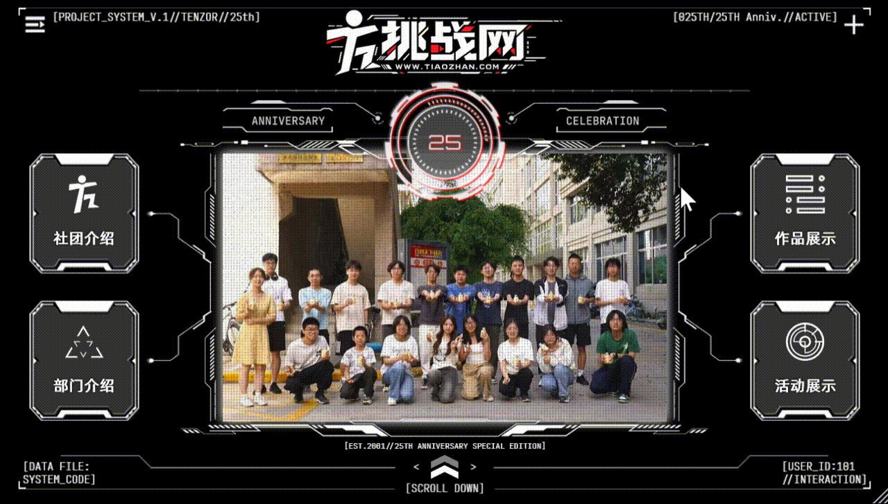
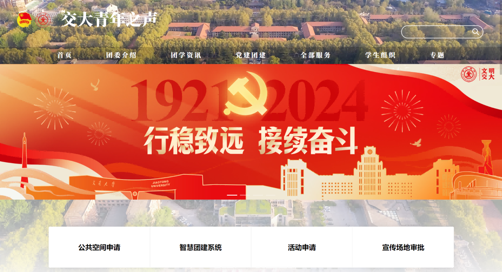

  <a href="https://www.tiaozhan.com/">
    <picture>
      
    </picture>
  </a>

<h1 align="center">西安交通大学挑战网</h1>

<b>西安交通大学团委挑战网创立于2001年</b>，它的前身是由交大承办的第七届“挑战杯”全国大学生课外学术科技作品竞赛的官方网站制作团队，该网站也是“挑战杯”史上首个网络宣传平台。

  
  
   

作为一个综合性的互联网新媒体社团，我们有着完整的部门体系，
 包含<b>视频部、技术部、美工部</b>三个技术性部门以及<b>团支部</b>。
 在这里，你可以学习设计搭建网站、拍摄剪辑视频、完成平面设计，不断为交大师生提供更加便捷优质的服务。

<table>
    <tr>
      <td colspan="2" valign="top">
      <h2>💻技术部</h2>
      技术部致力于 网站的设计开发 及 服务器与网站的运行维护， 帮助各学院、社团、校内外机构搭建了 数十个网站。
       技术部主要能力以 web技术栈 为主, 有充足的能力和资源开发各种 网站、小程序。维护各种系统。另外还兼有 桌面开发 的部分能力。
      <h3>在技术部，你将能够</h3>
       参与 网站设计与开发，工具框架的使用，服务器运行维护，你将学习到 HTML、CSS、JS、Golang、Gin、MySQL、Redis、Vue3、Axios、Linux、Nginx、Docker等内容。
       <h3>作品展示</h3>
       <a href="https://www.tiaozhan.com/">
        <picture>
      
        </picture>
        </a>
       
      挑战网首页, 2026
       
      <a href="https://tuanwei.xjtu.edu.cn/">
        <picture>
      
        </picture>
        </a>
       
      交大青年之声, 2026
      </td>
    </tr>
    <tr>
    <td width="50%" valign="top">
      <h2>🎬视频部</h2>
      视频部主要负责 各种视频前期拍摄、后期剪辑及特效制作，负责校内的一些 大型活动的录制、宣传等工作。
      <h3>在视频部，你将能够</h3>
      成为 微电影、纪录片、MV导演，或是 摄影师、特效师、剪辑师，数台专业单反、微单、电影摄影机、专业无人机、稳定器、三脚架、灯、麦等 完备的专业设备将任由你使用， 你将学习到 Adobe Premiere Pro、Adobe After Effects、Adobe Audition、DaVinci等软件的使用。
      <h3>作品展示</h3>
       <a href="">
        <picture>
      
        </picture>
        </a>
       
      招新视频, 2025
       
      <a href="">
        <picture>
      
        </picture>
        </a>
       
      【双十一特辑】西交爱情故事 | 如果不曾与你邂逅, 2026
      </td>
      <td width="50%" valign="top">
      <h2>🎨美工部</h2>
      美工部主导 WEB设计、移动端设计、印刷品设计工作，同时承接校内外 大型视觉设计工作。灵活配合各部门工作，提供专业的视觉指导。
      <h3>在美工部，你将能够</h3>
      学习到 平面设计理论与实操，你将能设计 独具风格的海报、网页等，你将学习使用 Photoshop、Adobe Illustrator、Adobe XD、Figma等软件，让你的创意成为社团的“视觉名片”。
      <h3>作品展示</h3>
       <a href="">
        <picture>
      
        </picture>
        </a>
       
      <a href="">
        <picture>
      
        </picture>
        </a>
       
      招新物料, 2025
      </td>
    </tr>
</table>
